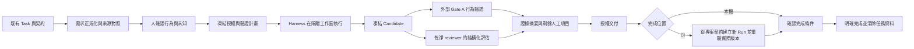

# 工程 AI 執行治理框架｜方向總覽

> 討論稿 v0.3｜規格日期：2026-09-30。2026-10-01 已加入 [OpenSpec 客製化示例](example/README.md) 與 [TypeScript gov CLI](packages/cli/README.md)：提供 Observe 前置檢查、驗證執行、review 接收與版本判斷；受保護治理核心、真實專案驗收及完成清理尚未完成。已確認方向與待定細節分列於第 6 節。

**建議繼續驗證這個方向，先證明「獨立驗收證據能降低人工 review 成本」，再擴充跨 Harness 的即時治理。** 原稿的控制、觀察、驗證與稽核機制在限定範圍內可實作；最不確定的是需求轉換的準確度、專案接入成本，以及總體上是否真的省下工程師時間。

## 1. 五分鐘確認方向

| 面向 | 整理後的方向 | 狀態／限制 |
|---|---|---|
| 解決的問題 | Agent 寫出的功能看似正常，但可能偏離需求；人工必須重新讀大量 diff | 原稿核心問題，需求強度待實際任務驗證 |
| 產品承諾 | 任務期間對指定版本、情境及驗證環境提供可追溯證據，列出未知與人工項目 | 不承諾功能全面正確或完成後永久稽核 |
| 主要使用者 | 使用 Coding Agent 的前端工程師與 reviewer；專案維護者設定共用政策 | 首批使用者假設 |
| 與現有工具分工 | 沿用 Task、SDD、Harness 與 CI；增加執行治理及需求到證據的對應 | 保留原稿定位 |
| 人的工作 | 開始前確認需求理解；途中處理有意義的例外；最後檢查剩餘風險 | 要計入全部介入時間 |
| 信任來源 | 固定版本的驗證器、隔離執行、完整測試紀錄、指定 Candidate 的結果 | `exit 0` 單獨不足 |
| 首個工具情境 | OpenCode Plugin＋Core／CLI＋按需 runtime＋獨立 verifier／reviewer | OpenCode 優先已確認；具體架構與版本相容待實作 |
| 驗證方式 | 能程式化的條件就程式化；重用既有檢查，新增測試要有契約、反例及增量價值 | 不用測試數量或模型信心代替有效證據 |
| 模型評估 | 乾淨 reviewer 回傳結構化理由、證據、限制與自報信心；以 Zod 接收驗證為提案 | 不綁 Jev；格式有效不代表判斷正確 |
| 資料位置 | Gov 資料放專案內；共用規則與任務暫存分開 | 不另建遠端 evidence store 或永久收據 |
| 最大未知 | 需求與畫面／API 的 binding 能否低成本建立，並找到 Writer 自己沒發現的錯誤 | 必須用 Prototype 回答 |
| 完成的定義 | 必要檢查、人工處置與交付條件成立後，明確結束 Task 並清除相關資料 | 本機完成或 CI 完成；Run 結束／PASS 不自動結束 Task |

**生命週期原則：一個 Task 可跨多個本機／CI Run。需要 CI 的任務保留必要契約到 CI 明確完成，程序與 session 不必一直運行；完成後移除任務資料，保留正式程式、測試與共用設定。**

## 2. 一張流程圖

執行中持續觀察變更；能可靠事前攔截的路徑才宣稱「阻擋」。事後 diff 能防止不合格成果被接受，無法撤銷已經發生的網路傳送或遠端寫入。

驗證失敗／未知時保留必要任務資料，修正後重跑。清理失敗時不能回報已清乾淨。CI checkout 刪檔、Git 清理變更與本機副本清理需分開處理，詳 [規格 10.1](docs/specification.md#ci-completion)。

## 3. 可行性判斷

| 能力 | 判斷 | 下一個驗證重點 |
|---|---|---|
| Controller、Candidate、Evidence、CI Gate | **工程上可行** | 權限分離、證據與交付版本一致、失敗復原 |
| Web 常見行為的範本式驗證 | **限定條件可行** | selector、API transport、fixture 與專案啟動的 binding |
| 跨 Harness adapter | **官方已有整合入口，仍須逐版本實測** | 中止、Hook 錯誤、背景行程與子工具的覆蓋 |
| 自然語言自動轉成正確驗收規格 | **尚未證實** | 漏項、錯誤理解、人類修正時間 |
| 通用 hardcode 偵測、語意影響分析 | **只能提供部分證據或風險訊號** | Dynamic probe 與人工確認，不能全面證明 |
| 減少 review 成本 | **產品假設** | 與「既有 CI＋AI reviewer」比較淨工時與漏失錯誤 |

查核依據、各工具差異及原稿修正理由見 [可行性與決策紀錄](docs/feasibility-and-decisions.md)。例如 Codex 官方明確列出 Hook 未涵蓋的執行路徑，因此不能將「有 Hook」視為完整攔截保證。[官方 Hooks 文件](https://learn.chatgpt.com/docs/hooks)

## 4. 必須先修正的六件事

1. **把「測試有跑」提升為「可信驗證有完整跑」。** Candidate 不能改驗證器、reporter、結果檔或通過標準；還要檢查預期測試是否缺漏。
2. **在 IR 與測試之間加入 Project Binding。** 「點擊簽到」需要對應真實路由、DOM、RPC 編碼和 fixture；JSON 本身無法自動提供這些資訊。
3. **分開需求分類、執行進度、驗證結論與接受決策。** `HUMAN_ONLY` 不是測試結果，`INCONCLUSIVE` 也不是已完成。
4. **將跨 Harness 能力改成有覆蓋範圍的契約。** 不用單一 `preToolInterception: true` 推論所有 shell、網路與遠端工具都受控。
5. **證據綁定實際交付版本。** 修復、追加 commit、更新 base 或合併其他 Candidate 後，要重新判斷證據是否有效。
6. **降低首版範圍並量測總成本。** 先 OpenCode 與有效驗證；多 Harness、常駐 `govd`、複雜 queue 延後。遠端 evidence storage 與永久稽核不列入目前範圍。

## 5. 建議的第一個驗證切片

| 階段 | 交付成果 | 才能進入下一步的條件 |
|---|---|---|
| P0：需求與驗收 Prototype | 代表性 FE Task、測試價值篩選、來源對照、6 類模板、Core／CLI 驗證、結構化 reviewer | 驗收器確實能攔下預設錯誤；無效模型回覆不會取得通過資格 |
| P1：OpenCode 與生命週期整合 | Plugin、按需 runtime、Task／Run、隔離驗證、本機完成清理，再加入 CI 明確完成 | 不偽造 PASS、不用舊版本證據；完成清理不遺漏或誤刪資料 |
| P2：日常使用評估 | Risk observer 先以 shadow mode 量測、再開少量攔截 | Review 淨工時下降；打斷有用，且重要偏差沒有增加 |
| P3：擴充 | 第二個 Harness／transport／前端技術組合，之後再做 autonomous worker | 不必重寫 Core；接入成本可接受 |

建議首版六類行為：初始狀態、pending／重複送出、成功轉換、失敗狀態、reload 以 server 為準、config 變動。Vue＋HTTP/JSON 可作為起點；若真實試點都使用 gRPC-web，應直接選該 transport，避免在簡單案例成功後才發現接入不可行。

## 6. 已確認方向與還需要決定的事

| 決策 | 狀態 | 閱讀入口 |
|---|---|---|
| D04：首先處理 OpenCode 情境 | 已確認方向 | [OpenCode 架構](docs/specification.md#opencode) |
| D13：能程式化就程式化，避免無意義測試 | 已確認原則；四項價值判斷為提案 | [測試價值](docs/specification.md#test-value) |
| D11：模型提供結構化參考，不依賴 Jev | 已確認方向；Zod／schema 細節為提案 | [模型回傳契約](docs/specification.md#structured-review) |
| D10／D14：資料在專案內，明確完成即清除；CI 任務在 CI 結束 | 已確認方向 | [Task 生命週期](docs/specification.md#task-lifecycle)、[資料範圍](docs/specification.md#task-storage) |
| D02：第一個真實專案與 transport | 待選定 | [完整決策表](docs/feasibility-and-decisions.md#f6) |
| D16：誰提交 Git 清理、如何驗最終 SHA、如何清本機副本 | 待設計與實驗，不能只刪 runner 檔案 | [CI 完成流程](docs/specification.md#ci-completion) |
| D17：未完成／取消／逾期任務的容量與丟棄規則 | 待決定，避免未完成任務持續累積 | [成本與限制](docs/specification.md#s12) |

完整治理框架的 Task／Run／session 與 Plugin API 仍是提案；目前 [gov CLI 0.1.0](packages/cli/README.md) 已實作並測試有限的 Observe 切片，與完整規格的差距見 [GAPS](example/GAPS.md)。Git 刪檔不會移除歷史；完成後也不保留 gov 的永久 audit。其餘信任邊界、權責及驗證門檻見 [完整決策表](docs/feasibility-and-decisions.md#f6)。

## 7. 完整閱讀入口

| 文件 | 用途 |
|---|---|
| [產品與技術規格](docs/specification.md) | 正式整理的系統邊界、資料契約、流程、Gate、範例與驗收條件 |
| [可行性、風險與待決策事項](docs/feasibility-and-decisions.md) | 分級結論、官方查核、取捨、實驗設計與停止條件 |
| [原稿 73 節對照](docs/source-map.md) | 每個原始概念的去向、保留／修正／延後理由 |
| [原始草案](docs/source/original-draft.md) | 原文保存，供核對與後續討論 |

閱讀方式：先看本頁第 1、4、6 節確認方向；有疑問再開規格對應章節；用 73 節對照檢查是否漏掉原始意圖。

v0.3 變更摘要見 [決策紀錄 F6](docs/feasibility-and-decisions.md#f6)，後續討論的逐項對照見 [來源對照](docs/source-map.md#discussion-updates)。介紹網站的既有互動模擬仍以 v0.2 為基礎，尚未模擬此次 Task 完成與清理流程；規格以本頁及 `docs/` 為準。
