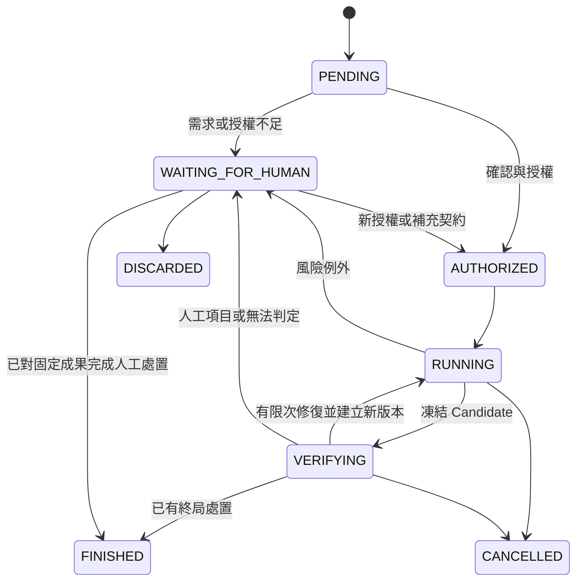

# 工程 AI 執行治理框架｜產品與技術規格

> 版本：v0.3 discussion draft｜更新日期：2026-09-30｜狀態：已納入後續討論，治理工具尚未實作。原稿為 Concept / Architecture Draft。
>
> 已確認的方向：先處理 OpenCode 使用情境；能程式化驗證的條件採程式化驗證；模型提供可驗證格式的參考評估；任務資料放在專案內，任務明確完成後清除，需要 CI 時在 CI 明確結束任務。具體 API、schema、狀態名稱與清理機制仍是實作提案，狀態見 [決策表 F6](feasibility-and-decisions.md#f6)。文中的「必須」表示實作應滿足的條件，並不表示已完成驗證。

<a id="s1"></a>
## 1. 產品目的與範圍

**產品定義：在既有工程任務與 Coding Agent 之間，建立受控執行、獨立驗證與可追溯證據，讓工程師能集中檢查仍然未知或需要判斷的部分。**

解決的偏差包含：config 被 hardcode、server authoritative 狀態被 client 推導、非預期相依套件或公共模組修改、實作與自寫測試共同誤解需求、failure／reload／concurrency 漏測，以及 Agent 宣稱通過但驗證未完整執行。

### 1.1 使用者與價值

| 使用者 | 工作 | 應獲得的價值 |
|---|---|---|
| 任務執行工程師 | 提供 Task、確認理解、處理例外 | 保留慣用 Harness，減少重複提醒與中斷 |
| Reviewer | 決定成果是否符合需求 | 直接看到驗證情境、版本與未涵蓋部分 |
| 專案維護者 | 維護共用政策、binding 與 verifier pack | 一次接入、多 Task 重用；知道維護成本 |
| 專案維護者／reviewer | 在任務完成前核對重要決策 | 可核對授權、變更、證據與人工判斷；完成清除後不提供永久稽核 |

首批使用者與付費意願尚未驗證。產品成效以**淨人工工時與偏差偵測**衡量，不以程式碼產量或綠勾數衡量。

### 1.2 邊界

- 輸入可以是 Prompt、PM 文件、GitHub Issue、Jira、OpenSpec、Figma 或 API 契約，不強制 SDD。
- 保留既有 Task 管理、需求文件、Coding Harness、CI 與人工 review。來源工具只提供 intent，不自動授予執行權。
- 不承諾自然語言規格的完整形式證明、不保證消除所有人工 diff review、不把 AI reviewer 的意見當成正確性證明。
- 不管理 Jira workflow、Figma lifecycle、QA case 平台或 PM dashboard；企業 RBAC、多團隊調度、合規認證與 Kubernetes／Kafka 不在首版範圍。
- 首個 Harness 為 OpenCode，Core 保留 adapter 邊界；不以同時支援其他 Harness 作為第一版條件。
- SpecWit 不建立遠端 evidence store、不以 CI artifacts 保存任務歷史，也不在完成後另留長期摘要或收據。專案透過既有 Git／CI 流程交付必要輸入；這與另外建置資料儲存服務不同。

### 1.3 保留的原則

Runtime-first、可程式觀察優先、跨 Harness 的 Core、漸進提高自治程度、共用專案政策、觀察實際 scope、例外才中斷、摘要先行與證據按需展開。工程師不必學新 DSL，也不必為每張 Task 手寫 path allowlist 或 verifier。

能程式化驗證的需求條件必須採程式化驗證，但不等於每個條件都要新增測試。先選擇有判別力的既有 checks，再補必要缺口；避免只重述實作的 assertion，詳 [測試價值規則](#test-value)。

<a id="s2"></a>
## 2. 名詞與狀態分層

| 名詞 | 定義 |
|---|---|
| Task | 一個工程任務的治理範圍，關聯既有任務來源；可跨本機及 CI 的多個 Run，不取代任務管理工具 |
| Verification contract | CI 可獨立讀取的任務驗證輸入，包含已確認的需求、BehaviorPlan、binding／fixture／pack 引用、模型 rubric 與 schema 版本 |
| Intent snapshot | 任務及相關規格在某個時間點的固定內容與 digest |
| Requirement | 有來源位置的需求；可對應一個以上 behavior |
| Behavior IR | 人已確認、可機械解析的行為描述；本身不是可執行測試 |
| Project Binding | 行為名稱到 route、selector、transport、fixture、啟動方式的對應 |
| Verifier Pack | 經維護與版本固定的模板、runner、reporter、規則及依賴 |
| Run | Task 在某個環境中的一次執行，有自己的授權與限制；可包含多個 Candidate revision 與 verification attempt。本機與 CI 使用不同 run ID |
| Harness session | OpenCode 等工具的對話／執行上下文；與 Task、Run、runtime 程序分開管理，session 結束不等於 Task 完成 |
| Candidate | 從工作區擷取的不可變成果快照；不等同持續變動的工作目錄 |
| Evidence | 外部觀察結果及其輸入、工具、版本、環境與完整性資訊 |
| Acceptance decision | 根據證據、人工處置與政策，判斷是否可接受指定成果 |

原稿將需求可驗證性與執行狀態混在一起。本提案改成以下獨立欄位：

| 層級 | 值 | 說明 |
|---|---|---|
| 需求驗證方式 | `AUTOMATABLE`、`PARTIAL`、`HUMAN_ONLY` | 自動化指程式化驗證；模型評估是另附的參考，不會把 HUMAN_ONLY 改成自動 PASS |
| 需求明確度 | `READY`、`NEEDS_CLARIFICATION` | 契約缺漏在 intake 就揭露，不假造答案 |
| Task phase | `ACTIVE`、`WAITING_FOR_CI`、`READY_TO_COMPLETE`、`COMPLETING`、`COMPLETED` | 提案名稱；只有明確完成且清理成功才到 COMPLETED，不永久保存該紀錄 |
| Completion target | `LOCAL`、`CI` | 在任務契約中確定；CI 任務不能由本機宣告完成，變更目標需由原決策權責者明確確認 |
| Run phase | `PENDING`、`AUTHORIZED`、`RUNNING`、`VERIFYING`、`WAITING_FOR_HUMAN`、`FINISHED`、`CANCELLED`、`DISCARDED` | `FINISHED` 只表示流程結束 |
| Check execution | `NOT_RUN`、`RUNNING`、`COMPLETED`、`ABORTED` | 防止漏跑被算進通過數 |
| Check verdict | `PASS`、`FAIL`、`INCONCLUSIVE`，未執行為 `null` | 觀察足夠才下結論 |
| Evidence validity | `CURRENT`、`STALE`、`INVALID` | 舊 Candidate 的 PASS 仍是歷史事實，但不能沿用到新成果 |
| Acceptance | `ELIGIBLE`、`BLOCKED`、`HUMAN_REQUIRED` | 合格不等於已授權 apply、push、merge 或 deploy |

UI 建議使用「指定情境已驗證」取代 `PROVED`。如保留原名，必須同時顯示 Candidate、情境、verifier 與未涵蓋範圍。

<a id="s3"></a>
## 3. 信任模型與治理強度

### 3.1 元件責任

| 區域 | 元件 | 權限／責任 |
|---|---|---|
| Trusted control plane | Controller、政策決策器、已審查 compiler／pack、Evidence writer、Signer、publisher | 建立授權、判定、寫證據與發布 check；不任意執行 Candidate 程式 |
| Untrusted execution plane | Harness、Candidate、repository scripts、Agent-written tests、build plugins、第三方套件 | 只在授權範圍執行；不能改控制器、驗證規則、簽章金鑰或通過紀錄 |
| 隔離的驗證環境 | 受控 runner 與 browser；另一個隔離區中的 app／build | runner 程式可受信任，但被執行的 Candidate 仍不受信任 |
| 外部權限邊界 | OS sandbox／容器／VM、受控網路與憑證、GitHub branch rules | 限制副作用與成果接受；不能只靠 prompt 或工具描述 |

信任模型至少防止 Agent 或 Candidate 誤改、刪除或偽造治理證據；不宣稱能抵抗主機 root、惡意治理管理員、未知 OS／browser 漏洞或所有測試投機行為。評估刻意針對測試作弊時，應增加威脅模型與成本，不把有限 probes 宣稱為全面證明。

**檔案放在 workspace 外不會自動安全。** 若 Agent 的 shell 與 `specwitd` 共用無限制的使用者權限，它仍可能讀寫外部路徑、呼叫治理 socket 或讀取憑證。強制模式必須以 sandbox 權限、不同身分、隔離 volume／行程建立實際邊界，且不得把控制器 socket、Docker socket、Signer 或 publisher credentials 掛入 Candidate。

本版資料保存在專案內；應以 mount／sandbox 權限保護治理目錄及控制端，不因檔案同屬 repository 就讓 Writer 可寫。一般工作樹或同使用者程序分離只提供邏輯隔離，無實際權限限制時不得宣稱 Controlled。

### 3.2 執行模式與能力 Profile

Developer／CI／Autonomous 是使用情境；以下 Profile 是保證範圍，兩者分開記錄：

| Profile | 能做的事 | 不能暗示的保證 |
|---|---|---|
| Observe | 外部 diff、部分事件、驗證摘要與風險提醒 | 不代表所有行為均已攔截或記錄 |
| Controlled | 在通過契約測試的工具及隔離邊界阻擋不允許操作 | 不等於外部服務副作用可以回復 |
| Certified candidate | 受保護 verifier、精確快照、完整結果與可信 publisher 的成果驗證 | 不代表 Run 曾受到完整 runtime 管控 |

原稿的本機低干擾與 CI authoritative Gate 保留；但 CI 主要控制**哪些成果被接受**，無法彌補執行時已洩漏資料或已進行的遠端寫入。

能力不足時回報 `UNSUPPORTED_PROFILE`，並阻擋該 Profile 的接受資格。可以由使用者明確改用較弱 Profile，不能靜默降級後維持同一保證標籤。

<a id="s4"></a>
## 4. 使用流程與生命週期

1. **Intake**：保存來源內容、版本、位置與 hash；標示互相矛盾或缺失的契約。
2. **Discovery**：以靜態讀取為主，找出 Git、package manager、scripts、CI、tests、schema、CODEOWNERS、generated files、套件邊界與相依關係。
3. **Normalization**：建立需求清單、行為、可驗證方式、binding 缺口及 unknowns。每條需求都要有去向。
4. **Human confirmation**：工程師確認可讀行為與來源、驗證方式、測試價值及完成位置，系統凍結 IR、binding、pack 和政策；確認的是理解，不是授權任意遠端操作。
5. **Authorization**：Controller 檢查身分、Profile、限制、期限與必要輸入，建立不可變授權。
6. **Baseline**：在已授權的隔離環境執行適用的現況檢查，保存已存在的失敗；新功能驗收在 base 上失敗可能是正常的。
7. **Execution**：Harness 在 private clone／worktree 工作。Observer 記錄範圍、套件與契約改動；符合例外門檻時提出具體請求。
8. **Freeze**：Controller 停止或隔離寫入者，擷取不可變 Candidate。驗證應在新的隔離快照執行，不邊改邊驗。
9. **Verification**：執行 Gate A，視 policy 執行 Gate B；保留每次 attempt 與 retry。
10. **Review**：顯示結果、未涵蓋範圍、待處置風險與人工項目。修復產生新 Candidate，不能覆寫舊證據。
11. **Delivery**：依另外的 action grant 匯出 patch、apply 或建立 PR。交付前重新比對 digest；merge 另由規則與 CI 判定。
12. **Integration**：base 移動、多 Candidate 合併或成果再修改時，針對最終整合 tree 重跑需要的檢查。
13. **Explicit completion**：依 `completion_target` 在本機或 CI 明確執行完成步驟，確認必要驗證、人工處置與交付條件均成立，再清除任務資料。驗證成功本身不自動觸發完成。

正常任務只在開始前、重大例外、結果 review 三個時機介入。5～15 條行為是摘要設計目標，**不是刪除需求或截斷檢查數量的上限**。

### 4.1 Run 狀態與復原規則

下圖是 Run，不是 Task。`FINISHED` 釋放該次執行資源，不會自行清除尚待 CI 的任務。



- 授權撤銷／過期：禁止開始新操作，要求 abort 並收回工作憑證；記錄不能即時停止的行程。已完成副作用不宣稱自動復原。
- 等待人類期間：保存 `resume_phase`、原因及 Candidate digest；不得占住長交易。逾期轉取消或未完成，不自動同意。
- Worker／controller 當機：依持久化事件復原；尚未收到完整 verifier result 的 attempt 為 `INCONCLUSIVE`，不得從最後一行 stdout 推論 PASS。
- 修復次數、時間、token／費用與併行數皆受 run limits 限制；預算耗盡代表未完成，不代表成功。
- 未知的 publish 結果以 idempotency key／遠端識別碼查證；不能直接重送可能建立第二個 PR 的請求。

<a id="task-lifecycle"></a>
### 4.2 Task 的完成位置與清理

| 模式 | 本機 Run 結束後 | 明確完成條件 |
|---|---|---|
| LOCAL | 顯示驗證結果與剩餘人工項目 | 本機受信任的完成入口確認條件成立，交付成果後清除 |
| CI | 保留必要任務契約，標示 WAITING_FOR_CI；本機程序可退出 | CI 以同一 task ID、新 run ID 重驗實際版本，再執行明確完成步驟 |

```text
ACTIVE → 本機驗證或 WAITING_FOR_CI → READY_TO_COMPLETE
→ 明確完成要求 → COMPLETING → 清理成功 → COMPLETED（不持久保留任務紀錄）
驗證失敗／未知 → 保留必要任務資料，修正後建立新 Run 或 Candidate
清理失敗 → 保持 COMPLETING 與尚需清理的最小狀態，可重試，不回報已清乾淨
```

- `session.idle`、模型說「完成」、Run FINISHED、驗證 PASS 或 CI job 結束，都不是 Task 的完成指令。
- 完成入口由 Controller 驗證權限、task／candidate／plan 身分、必要檢查、人工處置與交付狀態。Writer 可以提出完成請求，不能自行批准或刪除證據來製造完成。
- 清理前停止持有該任務資料的 worker，拒絕遲到結果；只清理 SpecWit 擁有且明確列入清單的資源。不得刪掉交付程式碼、正式測試、使用者未交付的修改、其他 Task 資料或使用者既有 OpenCode 對話。
- 已完成 Task 不再維持可恢復的對話、授權或永久 run history。後續工作建立新 Task，使用專案共用規則與正式測試，不能沿用舊接受決策。
- 未完成、取消、逾期 Task 的容量限制及明確丟棄流程待定；不得只因超時就算成功，也不能默默刪除唯一交付資料。詳 [D17](feasibility-and-decisions.md#f6)。

CI 工作目錄清理、Git 追蹤資料的移除與本機剩餘副本是不同清理目標，詳 [CI 完成流程](#ci-completion)。

<a id="s5"></a>
## 5. 核心資料契約

以下是最低欄位要求，具體 JSON Schema 與 API 版本留待 Prototype。所有 hash 應標示演算法與 canonical encoding；ID、hash、時間戳各有不同用途。

| 實體 | 必要欄位 |
|---|---|
| Task | `id`、來源任務引用、`completion_target`、phase、plan／contract revision、run IDs、資源擁有者與清理範圍；完成時刪除 |
| VerificationContract | `schema_version`、`task_id`、plan／rubric／review schema、binding／fixture／pack／policy 引用及 digest、預期 checks、確認來源；不得把自填 confirmed_by 當可信身分 |
| IntentSnapshot | `id`、`source_type`、`source_ref`、`revision`、`content_digest`、`captured_at`、`source_spans`、存取分類 |
| Requirement | `id`、`source_refs`、敘述、`criticality`、`verification_mode`、`readiness`、`behavior_ids`、未涵蓋原因 |
| BehaviorPlan | `schema_version`、`requirements`、`behaviors`、`binding_digest`、`verifier_pack_digest`、`confirmed_by`、`confirmed_at`、`plan_digest` |
| Authorization | `id`、actor／授權來源、intent／plan digest、repo identity、base commit／snapshot digest、controller／policy／pack digest、Profile、limits、到期、允許 action、`supersedes` |
| Candidate | `id`、`run_id`、revision、base、commit／tree／artifact digest、檔案清單、外部材料 digest、凍結時間 |
| VerificationAttempt | Candidate／plan／binding／pack／environment digest、預期 check IDs、實際 check IDs、開始與結束、execution、verdict、原因、retry 關聯 |
| Finding | rule ID、嚴重度、證據位置、影響範圍、可信度／觀察限制、disposition、審核者 |
| ReviewResult | 已驗證的結構化 assessments，加上 Controller 附加的 task／run／candidate／plan／model metadata；詳第 7.3 節 |
| HumanDecision | actor、身分來源、對象 requirement／finding／action、Candidate 或 operation digest、reason、期限、時間、approval／rejection |
| RunManifest | task ID、上述 ID 關聯、Harness／adapter 版本、requested／observed model、observation source、遺漏事件資訊、最終 phase／acceptance、audit root；任務期間使用，不永久保存 |

### 5.1 授權更新

Run 不能修改自己的授權。Scope expansion 要建立新的、可追溯的 authorization revision，連結舊授權；原始紀錄不覆寫。批准 shared file 變更，只適用該操作或指定範圍，不等於授權所有後續修改。

變更需求理解、binding 或 verifier pack 時，重新確認並建立新 plan；舊 PASS 不自動轉移。候選分支上的 `.governance/` 僅是政策變更提案，當前 Run 仍使用已信任、hash-pinned 的版本。

### 5.2 Candidate 完整性

Commit hash 可識別 Git 物件，但執行輸入也可能包含 dirty files、未追蹤檔案、submodule、LFS、symlink、產生檔與外部 fixture。Prototype 應宣告支援範圍；不支援者拒絕或列為缺口，不能漏掉後仍宣稱快照完整。

若支援帶未提交修改的 base，先建立私有 snapshot，保留使用者工作區；不能直接 reset 或 clean。Ignored files 不自動納入，以明確的 materials 清單決定哪些輸入進入快照。

交付必須使用驗證過的 artifact，並在寫入目標前確認其 digest 與目標 base。若仍允許其他行程修改同一目錄，檢查 hash 後再複製也有 race；應採不可變 snapshot 與受控、具前置版本檢查的發布流程。

<a id="s6"></a>
## 6. Requirement Normalization、IR 與 Project Binding

### 6.1 需求不能在摘要中消失

每段 source requirement 必須對應以下至少一項：自動 behavior、部分自動加人工檢查、人工檢查、待澄清、明確不在本 Task 範圍。最後一種也需理由與人確認。多條 behavior 不應重複計算成多條原始需求的完成率。

使用者確認畫面顯示來源、系統理解、測試情境、未覆蓋條件和需人工確認的 binding。沒有證據支持的 LLM 推斷標成 assumption，不能當成需求。

### 6.2 採有限模板而非通用程式生成

建議管線：

```text
自然語言與契約 → LLM 提出行為草稿 → schema / 支援能力檢查
→ 人確認行為與關鍵 binding → 凍結 plan
→ 受維護的模板＋Project Binding → 外部 verifier
```

同一份已凍結 IR、binding、compiler 版本應產生相同測試計畫；這是 deterministic compilation。執行仍可能受到 timing、瀏覽器、環境影響，不能宣稱天然無 flaky。

不允許 IR 塞入任意 shell／JavaScript 作為 assertion。需求可程式化但既有模板無法表示時，先標示 unsupported，再補受審查模板或適合的程式化檢查；只有確實無法程式化的部分才列人工並附模型參考。不能把工具暫不支援當成 HUMAN_ONLY，也不能偷偷呼叫 LLM 自由生成測試，再把結果標成 deterministic acceptance。

### 6.3 IR 範例

以下為結構示意，ID／digest 都是占位值，並非已實作 schema：

```json
{
  "schema_version": "0.1-proposed",
  "id": "BH-CHECKIN-ERROR",
  "requirement_ids": ["REQ-ERROR-01"],
  "template": "request-error-preserves-state@1",
  "binding_ref": "daily-checkin@1",
  "given": {
    "status": "AVAILABLE",
    "checkin_response": "APPLICATION_ERROR"
  },
  "when": [{ "action": "activate", "target": "checkin-cta" }],
  "then": [
    { "observation": "request-count", "operation": "CheckIn", "equals": 1 },
    { "observation": "visible", "target": "error-message", "equals": true },
    { "observation": "visible", "target": "completed-state", "equals": false }
  ],
  "observation_window": { "start": "action", "end": "response-settled", "timeout_ms": 5000 },
  "limitations": ["不證明後端交易與跨裝置冪等性"]
}
```

### 6.4 Binding 的責任與成本

| Binding | 必須處理的內容 | 維護原則 |
|---|---|---|
| App startup | package manager、安裝／build／啟動命令、port、ready signal | Discovery 只提出候選；執行前納入授權，在隔離區啟動 |
| UI | route、role／accessible name／test ID、locale、唯一性 | 找不到／多重匹配要報錯，不能由 LLM 任意猜 |
| Transport | HTTP method／path、RPC method、編碼、error envelope、串流 | HTTP JSON、gRPC-web、Connect、WebSocket 分別支援 |
| Fixtures | session、permission、資料、clock、timezone、config、storage | 可重建、隔離、具版本；不使用真實敏感資料 |
| Observation | request count、DOM state、外部 response、輸出變化 | 不只相信 app 自己回報的「成功」標記 |

Binding 可以由系統提出並在接入時確認；Candidate 對 binding 的修改是提案，不能直接改寫當次驗收。新頁面無法事前找出 selector 時，可分兩階段確認，但新增的人力成本必須納入量測。

Playwright 提供 HTTP(S) request 攔截與 mock，可作為 Web verifier 的基礎；RPC 的語意、fixture 與 binary codec 仍需 adapter。[Playwright Mock APIs](https://playwright.dev/docs/mock)

Network interception 需處理 Service Worker／既有 MSW 的可見性；若因此停用 Service Worker，Evidence 必須聲明該模式不涵蓋正式 Service Worker 行為。[Playwright Network](https://playwright.dev/docs/network)

<a id="s7"></a>
## 7. Gate A、Gate B 與接受政策

### 7.1 Gate A：可機械判定的驗證

對可程式化判定的需求條件，必須取得程式化驗證結果；不能以模型高信心取代。條件可程式化但暫缺 adapter／binding／環境時，列為缺口或 `INCONCLUSIVE`，補齊支援，不能假裝成已驗證。

| 類別 | 範例 | 證據定位 |
|---|---|---|
| Repository checks | typecheck、lint、build、unit／integration tests | 有價值，但 repository-controlled scripts 與 tests 不能成為唯一驗收依據 |
| Governance acceptance | 凍結 behavior、外部 UI／request 觀察、contract validation | 依獨立計畫驗證需求，在指定情境範圍內成立 |
| Change invariants | dependency diff、generated integrity、public API、filesystem、scope | 以固定規則與輸入判定；不適合硬判者改列 finding |

PASS 至少同時滿足：執行身分與輸入有效、預期 checks 全部執行、assertions 完成、結構化結果完整、沒有未允許的 skipped／missing checks、digest 與 Candidate 相符。只讀一個 `exit 0` 不足。

reporter／result channel 必須由受信任 runner 控制；Candidate stdout 中的 `PASS`、偽造 JSON 或結果檔不具判定權。不要讓 app build 與 verifier runner 共用可寫的規則、reporter、結果目錄、process control 或 credentials。

| 情況 | 結論 |
|---|---|
| 在有效環境下 assertion 明確不符 | `FAIL` |
| 確認禁止的政策變更／證據竄改 | 對應完整性或政策 check `FAIL` |
| Browser 無法啟動、fixture 缺失、未知 transport、事件不完整 | `INCONCLUSIVE`，帶機械可讀 reason |
| 有可信執行證據的 app build 錯誤 | build check `FAIL`；未執行 behavior 不能偽造為 assertion FAIL |
| 到達行為允許的 deadline，且 app／觀察器正常 | 行為 check `FAIL` |
| timeout 成因不明，無法區分 app 與基礎設施 | `INCONCLUSIVE` |
| Retry 第一次 fail、第二次 pass | 保留全部 attempts，標示 flaky；依預先設定政策處置，不只留下最後綠勾 |

<a id="test-value"></a>
#### 7.1.1 避免為測而測

驗證計畫依序選擇：重用有判別力的既有 checks、補最小必要檢查、確實無法程式化的部分再取得模型參考與人工處置。這不要求把既有 tests 全部複製成另一套 verifier；應獨立確認其契約來源、執行身分與結果完整性。

新增測試至少應回答以下問題，記錄在計畫中，不要求工程師逐條手寫表單：

| 判斷 | 必要說明 |
|---|---|
| 保護什麼契約？ | 可追溯的需求、外部介面或不變條件；預期值不能只抄當前實作 |
| 能抓到什麼錯誤？ | 一個合理且有影響的反例，說明失敗會造成的行為偏差 |
| 增加什麼證據？ | 既有 typecheck／schema／test 尚未涵蓋的部分；重複檢查需有額外理由 |
| 成本是否合理？ | 選足以驗證該契約的最小層級，計入 CI runtime、flaky 與維護負擔 |

例如內部常數物件 `{ retry: 3 }`，再測它等於 `{ retry: 3 }`，通常只是重述定義。若 `3` 是正式協定的 wire value，且測試驗證實際序列化輸出是否符合獨立契約，則有保護相容性的價值。是否測常數不能只用語法決定。

Mutation／缺陷注入用於確認已選定的驗證器有判別力；能殺死 mutation 不代表契約值得測，也不要求每個 PR 全量 mutation testing。AST 與模型可標示疑似低價值測試，但不能直接刪除已要求的 checks；驗證範圍的調整需經既有計畫確認流程。

### 7.2 Baseline 與回歸

Base 與 Candidate 使用可比較的環境及檢查計畫。既有失敗以穩定 check ID、失敗 signature、位置與範圍比對；`2 FAIL → 2 FAIL` 不能證明沒有新回歸。刪測試、改 discovery、減少 assertion 或增加 skip 必須揭露。

Baseline exception 需要責任者、理由與期限。它可以容許已知、無新增惡化的 legacy check；不能把本 Task 的必要驗收失敗視為既有問題而接受。新功能在 base 尚未存在，base 上對應 behavior FAIL 不應自動阻止工作。

<a id="structured-review"></a>
### 7.3 Gate B：結構化模型評估與語意風險

Review architecture、abstraction、需求重新解釋、疑似 hardcode、測試投機與設計意圖。可以使用不同模型／Harness，但模型不同不保證獨立或無共同盲點。

Finding 必須含檔案／行為位置、理由、影響與建議觀察；不得只給信心分數。沒有 finding 不代表正確。高嚴重度 finding 依 policy 要求人工處置；Agent 不能自行將其標為已接受。

經人確認且可形式化的 finding，應轉為新版本的 Gate A rule／template；無法形式化者保留為 semantic rule 或人工項目。不要偷偷修改正在執行的 frozen verifier。

#### 7.3.1 乾淨的評估環境

不依賴 Jev 或特定模型服務。每次 review 建立新的 reviewer session，提供已確認的需求、rubric、固定 Candidate、必要原始規格與可核對證據；不繼承 Writer 對話或 Writer 自評結論。缺少必要資訊時回報 unknown，不為了「乾淨」而移除判斷需要的上下文。

Reviewer 使用受控設定、唯讀材料與工具白名單；不自動載入 Candidate 的 plugins、skills、AGENTS 或其他可改變評估規則的設定。讀到的來源文件當作待評估資料，不當作高優先權指令。Reviewer 無權修改程式、policy、verifier 或批准完成。程式化檢查由獨立 runner 執行。

新的 session、程序或工作目錄不自動代表安全隔離，必須實測設定載入與 OS／容器權限；隔離能降低對 Writer 的依附與干擾，不能保證模型判斷正確。

#### 7.3.2 回傳契約

採 Zod 作為 runtime schema validation 的實作提案；可用 provider／OpenCode 的 JSON Schema structured output 協助產生格式，但最終由 Controller 驗證才接收。這保證「只接受有效資料」，不保證模型第一次就能輸出有效資料。[Zod schemas](https://zod.dev/api)、[OpenCode SDK](https://opencode.ai/docs/sdk/)

最低回傳結構如下，精確 schema 版本在實作時固定：

| 欄位 | 約束 |
|---|---|
| `schemaVersion` | 此提案為 literal `1`；外層及 assessment 均拒絕未知欄位 |
| `assessments` | 非空 assessment 陣列；每個預期 criterion 恰有一筆，不得重複或漏列 |
| `criterionId` | 非空字串，必須屬於此次凍結的 rubric |
| `verdict` | `meets`、`does_not_meet`、`unknown`，與 Gate A 的 PASS／FAIL 分開 |
| `confidence` | 前兩者為 0～1 的有限數字；unknown 必須為 `null` |
| `rationale` | 非空字串，說明判斷理由 |
| `evidenceIds` | 此次 Candidate 真實存在且可讀取的 evidence ID 陣列；有結論時需可核對依據，缺證據回 unknown |
| `limitations` | 非空字串的陣列；無已知限制可用空陣列，不能藉此宣稱完整正確 |

例如：

```json
{
  "schemaVersion": 1,
  "assessments": [
    {
      "criterionId": "reward-feedback",
      "verdict": "unknown",
      "confidence": null,
      "rationale": "只有靜態截圖，無法判斷動畫的節奏與回饋。",
      "evidenceIds": ["screenshot-01"],
      "limitations": ["缺少動畫錄影或可操作的預覽"]
    }
  ]
}
```

處理順序為：schema parse → criterion 覆蓋／唯一性檢查 → evidence 引用及 Candidate／版本對應檢查 → Controller 附加實際 task／run／model metadata。模型不能靠自填 ID、model 名稱或 evidence 引用取得信任。

格式錯誤可在有限次數內要求修正；超過上限、逾時或引用不符時回報評估無效／無法判定，不能包成通過。Schema 有效仍不代表理由正確或證據支持結論。`confidence` 是模型自報參考值，未經校準不得當成正確率、完成門檻或覆寫 Gate A FAIL 的依據；第一版不要求另建信心校準平台。

### 7.4 聚合規則

```text
ELIGIBLE = 所有必要 acceptance checks 為 CURRENT + PASS
           且適用 repository policy 已滿足（含明示的 legacy exceptions）
           且所有必要人工項目有有效決策
           且沒有未處置的 blocking findings
           且 authorization 有效，candidate digest 未改變
```

任何必要 check 的 `NOT_RUN`／`INCONCLUSIVE`／`STALE`／`INVALID` 都阻擋自動接受。允許的例外要獨立顯示，不能改寫原始 FAIL 為 PASS；必要行為改變應修改需求契約、重新確認與驗證。核准人工品質項目可以完成其人工流程，但不能偽裝成自動驗證。

<a id="s8"></a>
## 8. 變更範圍與風險控制

### 8.1 Discovery 與共用政策

從 CODEOWNERS、Git history、tsconfig、package boundaries、static imports、generated headers、CI、既有測試、OpenAPI／Proto／GraphQL 取得建議。它們是線索：CODEOWNERS 是責任分配，不自動代表高風險；dynamic import、reflection、DI 會使 graph 不完整。

專案維護者只設定可重用知識：critical auth／payment／checkout、migration、generated read-only、dependency、deployment／CI config 等。已信任 base 的設定才可成為當次政策；Candidate 不能降低自己的限制。

### 8.2 風險訊號與處置

| 訊號 | 初期建議 | 判斷限制 |
|---|---|---|
| 套件增減、lockfile、CI／build config、migration、測試移除 | 明確規則，產生 finding 或要求特定授權 | 合理 Task 也可能需要改動，應看授權及語意 |
| Critical module、public API、generated source | Repo policy 決定阻擋／人工處置 | Generated files 應經指定 generator 再產生，不能一概禁止生成更新 |
| High fan-out、大量刪除、巨大 diff | 先 shadow mode，量測後才升級中斷 | 格式化、搬移與型別變更可能造成大量誤報 |
| 新 endpoint／env var、疑似 business constant | 風險 finding，結合動態 probe | 靜態搜尋不能全面判斷用途或 hardcode |

`212 dependents` 是影響線索，不是自動危險分數。例外請求要說明修改內容、原因、受影響範圍與可選處置；相同操作群組可批次處理，避免每次儲存都跳視窗。

工具事前攔截、工作區變更觀察、凍結後 diff 三者互補。Observer 必須區分「事前拒絕」與「已發生、等待處置」；後者可以暫停或隔離 Candidate，不能宣稱已撤銷。要避免讀取秘密或遠端寫入，必須在執行前以權限與受控工具限制。

### 8.3 Dynamic probe

若需求是 output 跟隨 config，使用不同有效值、邊界值與預先定義的變形關係檢查；保存 seed 與 input digest，讓測試可重跑。通過有限組輸入只能證明這些情境，不代表不存在 hardcode。

<a id="s9"></a>
## 9. Harness、Plugin、MCP 與 specwitd

### 9.1 分工

Skill 提供模型合作方式；MCP 提供 `specwit_status`、`specwit_get_findings`、`specwit_request_expansion`、`specwit_submit_candidate`；Hook／Plugin 收集事件、對支援的路徑作出決策。這些都不能讓 Agent 自行授權、寫入 final verdict 或取得簽章能力。

Webhook 僅 trigger：驗證來源、去重、防重播，再由 Controller 查 actor、Task 與 policy。事件 body 不直接變成 shell 命令或 action grant。

### 9.2 Adapter 契約

```ts
interface HarnessAdapter {
  capabilities(): Promise<CapabilityReport>
  execute(input: AgentRunInput): AsyncIterable<HarnessEvent>
  abort(runId: string): Promise<AbortReceipt>
}
```

Capabilities 不只 boolean，至少包括 Harness／adapter version、event families、受攔截的 tool paths、限制、sandbox 類型、interactive approval 行為、read-only mode 的實際權限、resume／abort 語意、model metadata 來源，以及契約測試結果。`structuredEvents` 與 `preToolInterception` 要附上覆蓋範圍；read-only 不能只是對模型的文字要求。

每個 event 含 `run_id`、adapter／Harness session ID、sequence、event ID、timestamp、tool correlation ID 與觀察來源。事件重複可去重，缺號或斷線需記錄 gap；Harness stream 不能自行宣告稽核完整。

Abort receipt 應說明已發送取消、主行程狀態、子行程是否確定停止。需要硬停止時由 sandbox supervisor 回收 process group／隔離環境，不把「API 回傳 true」等同所有工作已停。

各 Harness 的已查核能力見 [可行性文件 F2](feasibility-and-decisions.md#f2)。Core 保持跨 Harness，第一版先完成 OpenCode adapter 的契約測試。

### 9.3 specwitd 的導入時機與 API 邊界

初期以 `specwit` CLI＋Core library＋外部 runner 建立垂直切片，再接 OpenCode Plugin 與按需啟動的 local runtime。Runtime 程序可由同專案共用，Task 的授權、plan、Candidate 與 Evidence 各自獨立；程序退出後從專案內資料恢復未完成 Task，不依賴常駐 daemon。

若採用 daemon：Local socket／HTTP 僅是 transport，仍需驗證呼叫身分與 run-scoped capability。Agent 憑證只能讀狀態、送提案；人類決策走獨立、已驗證身分的 channel。不能以同一個 token 同時提供 `submit_candidate`、`approve` 與 `sign_pass`。

### 9.4 Model route evidence

分開記錄 `requested_model`、`observed_model`、provider、Harness 版本與 observation source。來源可為 provider response、Harness metadata 或 adapter observation；無資料填 `unknown`。自述模型名稱不是 evidence，路由回報的 alias 也不必然證明底層固定模型版本。

<a id="opencode"></a>
### 9.5 OpenCode 首版架構提案

```text
OpenCode Writer + 輕量 Plugin
          ↓ events／task-scoped tools
SpecWit Core／CLI + 按需啟動的 Local Runtime
          ├─ Task／Run／授權／Candidate／完成與清理
          ├─ 程式化 verifier worker → Gate A
          └─ 獨立 OpenCode reviewer worker → 結構化評估 → Zod＋引用檢查
所有 SpecWit 持久資料與暫存資料置於專案內；CI 重用 Core 建立自己的 Run
```

| 元件 | 責任與限制 |
|---|---|
| Plugin | 對接 before／after events、狀態與使用者介面，不掌握最終接受／批准權 |
| Core／Runtime | 管理 task ID、run ID、版本、計畫、授權、資源擁有者與清理；以單一 TypeScript codebase 為提案，不拆微服務 |
| Verifier worker | 在受保護的環境執行凍結計畫，不信任 Writer stdout 的 PASS |
| Reviewer worker | 每次新 session、獨立受控設定與工作目錄；唯讀 rubric／Candidate／Evidence，不 fork Writer 對話 |
| Project storage | 未完成任務的可攜契約與各 Run 暫存資料分開；必要時使用專案內 SQLite，不增加遠端 store |

工具先提供 `specwit_status`、`specwit_get_findings`、`specwit_submit_candidate`、`specwit_request_expansion`；名稱為設計提案。Submit 由 Controller 凍結 snapshot；工具事件只標記可能有變更，不能每次 after／idle 就直接評估或完成。同一 Candidate digest 的重複事件去重，reviewer 事件不得再觸發自身 review。

OpenCode 官方文件提供 plugins、session API 與 JSON Schema structured output；這些是接入入口，版本相容與錯誤語意仍須實測。[Plugins](https://opencode.ai/docs/plugins/)、[SDK](https://opencode.ai/docs/sdk/)

OpenCode 會合併多層設定，因此建立新 session 不等於不載入 repository 設定。Reviewer 必須明確控制 config、plugins／skills、規則、工具及資料目錄；SpecWit 建立的 reviewer storage 應置於專案內隔離區，能力不足時不得宣稱乾淨環境。使用者既有 Writer session 由使用者管理，不因 SpecWit Task 完成而自動刪除。[Config](https://opencode.ai/docs/config/)

多 Task 同時執行時使用各自 snapshot／工作區；只有不同 task ID 不足以防止同一工作目錄互相污染。第一版可先單一 active Run；併行是後續能力。

<a id="s10"></a>
## 10. CI、交付與多 Candidate

CI 使用受信任 revision／artifact 的 Controller、policy、binding、pack 與 reporter，驗證隔離的 Candidate。GitHub check 綁定實際 commit／integration tree 與 run manifest；Check publisher credentials 不可交給執行 Candidate code 的環境。

要成為成果接受的強制邊界，必須設定 required check、適用分支／ruleset、可發布結果的來源、bypass 規則，以及 base 更新／merge queue 的再驗證策略。GitHub required checks 可能接受 `skipped` 或 `neutral`，因此本系統的未知／漏跑結果不可映射為它們；建議 summary check 只在真正 `ELIGIBLE` 時發 `success`，其餘完成狀態發 `failure`，等待期間維持進行中。[GitHub protected branches](https://docs.github.com/en/repositories/configuring-branches-and-merges-in-your-repository/managing-protected-branches/about-protected-branches)

具寫入權的 workflow 不得直接 checkout 並執行不受信任 PR code；分離無特權驗證環境與結果 publisher，後者核對 artifact 來源、run／commit identity 和完整性。[GitHub Actions secure use](https://docs.github.com/en/actions/reference/security/secure-use)

本產品不取代 CI；以既有 CI 觸發驗證，讓 governance summary 成為可要求的獨立結果。純 Gate A 可直接使用 runner；需要 Gate B 時啟動隔離 reviewer，只有修復或 autonomous 任務才需要 Writer。

<a id="ci-completion"></a>
### 10.1 在 CI 明確結束 Task

CI 模式沿用相同 task ID，從專案取得已確認的 verification contract，以新的 run ID 驗證實際 head／integration tree。CI 不恢復本機對話、不採信本機 PASS，也不要求下載本機 raw Evidence。必要 fixture／rubric／binding 必須可由專案的受控輸入重建，不能只留在 gitignored 目錄；缺少輸入即阻擋該 Task，不能當作「沒有任務所以通過」。

候選分支中的契約是待核對輸入；CI 必須核對有效的確認來源與 digest，使用受信任的 policy／verifier。自填 `confirmed_by` 或 PR 同時放寬通過標準，不代表已獲批准。

CI workflow 分開「驗證」與「明確完成」步驟。只有必要 checks／人工處置／交付條件全部滿足，且完成要求來自受信任入口，才可清理。一般 push 的驗證不必每次都結束任務；是否為 finalization run 必須明確，不能用 job 正常退出推論。

| 清理目標 | 必須處理的事項 |
|---|---|
| 該次 CI checkout／worker | 停止 SpecWit-owned worker，清除任務 runtime 資料；保留交付程式與正式測試 |
| 已納入 Git 的任務契約 | 產生並依授權交付清理變更；刪 runner 檔案不會改 repository。清理不重寫 Git 歷史 |
| 本機保留的相同 Task | 透過專案同步後明確核對完成狀態，再清理本機副本；CI 不能直接清除離線電腦 |

Git 清理的執行身分、分支／PR 流程，以及本機如何辨識已完成而非資料意外缺失，列為 [D16 待決策](feasibility-and-decisions.md#f6)。不得為解決同步而預設新增永久完成收據或遠端資料服務；也不能只因檔案消失就自動刪除本機未交付成果。

如果清理已追蹤檔案會改變交付 SHA／tree，不能把舊 PASS 直接套到新版本。完成流程必須以受保護的暫存契約驗證實際最終版本，或對清理後版本重新執行必要驗證，再發布對應版本結果；所需契約不得先刪到無法執行。CI 完成與清理端到端機制通過 AC20～AC22 前，不宣稱已支援。

SpecWit 不上傳任務 logs／截圖／manifest 到 CI artifact store。CI 服務自身的 job log、check、PR 與 Git 歷史仍由既有平台管理；「SpecWit 清除任務資料」不代表清除這些平台紀錄，輸出時避免傾印任務敏感資料。

### 10.2 多 Candidate 與整合

首版單 Candidate。未來多 Candidate 可採 human selection 或事前定義的 deterministic policy。若稱 first-pass，需明確定義依序執行的候選順序，或記錄並行時到達順序與 tie-break；「最先完成」不保證重跑會選到同一個。

各 Candidate 通過不等於合併後通過。對 final integration tree 重跑必要 Gate A 與適用 Gate B；即使 Git 沒有文字衝突，語意相依仍可能失效。

<a id="s11"></a>
## 11. Evidence、Audit 與儲存

### 11.1 四層檢視

| 層級 | 顯示內容 |
|---|---|
| L0 摘要 | Task、Candidate、Profile、已驗證／失敗／未知／未跑／人工數量、接受狀態、重要風險 |
| L1 需求證據 | 原始需求、對應 behavior、輸入／觀察／結果、情境限制、人工處置 |
| L2 執行 | pack／binding／runner 版本、時間、環境、attempts、retry、check 完整性 |
| L3 原始紀錄 | 已遮蔽敏感資訊的 tool stream、stdout、trace、mutation 與決策事件 |

分開統計 requirement 與 scenario：一個需求的 20 個參數案例不能顯示成 20 個需求已完成。PARTIAL 必須拆出剩餘人工部分；Risk Low 不得掩蓋 missing evidence。

### 11.2 Audit chain

重要事件包括 intent／base、授權、controller／policy／verifier、Candidate、Gate、risk、人工決策、model metadata、交付 artifact 與 final commit。

建議以 canonical event encoding、`run_id`、連續 sequence、前一 digest 計算 hash chain，例如 `SHA256(canonical({version, run_id, sequence, previous_digest, event}))`，對 root／checkpoint 簽章；Verifier 使用可信 public key 核對 signer identity。金鑰放在 Agent 不可觸及的位置，事件只能經受權限保護的 Evidence writer 寫入。

**Hash chain 本身只能揭露不一致，不能防止完整重寫、整段刪除、rollback 或漏記事件。** 比對已知可信 checkpoint／最終 manifest 才能辨識缺尾；本機 root 控制整套系統仍不在保證範圍。本版不導入外部 anchoring 或 audit store；此機制只在任務資料尚存時供核對，完成後與任務資料一併清除。

<a id="task-storage"></a>
### 11.3 專案內儲存，明確完成後清除

此節取代 v0.2 的長／中／短期 retention 與 CI artifacts 方案。SpecWit 任務資料全部保存在專案內；完成後不保留額外摘要、收據、tombstone 或 run history。以下路徑為提案：

```text
.governance/
  policy/                    共用政策，隨專案維護
  bindings/                  共用 binding，隨專案維護
  verifiers/                 共用 verifier 設定／版本引用
  tasks/<task-id>/            尚未完成的精簡契約；CI 所需部分納入 Git
  runtime/<task-id>/<run-id>/  本機或 CI 的狀態、Evidence、暫存與 reviewer 資料；不納入 Git
```

| 資料 | 任務期間 | 明確完成時 |
|---|---|---|
| Task 契約、plan／授權、Candidate、manifest、Gate、人工處置、audit | 按 task ID 關聯，保留必要版本以供驗證與復原 | 清除；不另建長期索引 |
| stdout、截圖、trace、模型結果、SpecWit-owned reviewer session | 專案內 runtime；只收集必要資料並遮蔽敏感資訊 | 清除檔案、DB rows、關聯快取及 SpecWit-owned session |
| 暫存 snapshot／工作區／程序 | 明確記錄資源歸屬與仍在使用的 Run | 停止後清除；未交付的使用者成果不得連帶刪除 |
| 共用 policy、schema、binding、verifier、正式程式與測試 | 隨專案版本維護 | 保留，不屬於任務暫存資料 |

CI 只接收可重建驗證所需的精簡契約，不把每次 Run 紀錄或大型二進位資料寫入 Git。刪除 Git 目前版本的檔案不會抹除歷史，所以不能把此設計宣稱為整個 repository 容量永久固定。

清理必須可重試、限制在明確 task-owned 範圍，不能依任意模型輸出的路徑遞迴刪除。共享資源需先確認無其他 Run 使用；SQLite／快取清理需涵蓋關聯資料，具體格式不強制。最小 cleanup 狀態只存到清理成功，不能以復原為理由留下永久完成紀錄。

完成後只保有交付成果與共用專案規則，不再承諾 SpecWit 可重播當時對話、提供完整歷史 Evidence 或恢復舊授權。「清除」指目前檔案與 SpecWit-managed 資料的移除，不承諾磁碟鑑識抹除、Git history 改寫或第三方平台資料刪除。

資料保存在專案內不表示使用遠端模型時完全不外送內容；選用的模型仍需接收必要 rubric／材料，依既有資料政策處理。這不構成額外遠端 evidence storage。

<a id="s12"></a>
## 12. 調度、成本與非功能需求

首版可前景單 Run；需要持久化 queue 時，可在專案 runtime 目錄使用 SQLite 管狀態與短交易，artifact 另存檔案。Filesystem queue 仍可作單機替代，但必須補上 crash recovery、lease、重複認領與落盤策略；rename 不等於完整工作佇列語意。完成任務的資料必須移除，不建立無限增長的 completed archive。

Provider slots 使用 lease、expiry、heartbeat、fencing token。過期 worker 回傳的結果必須被 Controller 拒絕，不能只靠 worker 自願停止；呼叫中的 provider request 不一定能撤銷，lease 到期也不代表實際費用已停止。

| 非功能要求 | 規格 |
|---|---|
| 重跑 | 固定輸入、版本、seed、browser／runtime、fixture；環境不可重建時揭露限制 |
| 完整性 | 缺結果、事件 gap、digest 不符不能成為完整受控執行證明 |
| 隔離 | 測試與安裝都視為任意程式執行；無 production credentials，網路最小授權 |
| 延遲 | Cheap local checks 走同步攔截；依賴圖／語意分析先非同步，避免每次 tool call 都跑模型 |
| 預算 | 顯示模型、CI compute、browser、storage 成本；最大 attempts、時間、token／費用有上限 |
| 可維護 | Schema／adapter／pack 版本相容矩陣；更新前重跑契約測試與缺陷 benchmark |
| 可攜 | Core 與 Harness／transport／UI framework adapter 分離；不以一次支援所有平台為前提 |

實際延遲、成本、單任務 attempts／容量上限與未完成 Task 的逾期／丟棄規則尚未選定，屬於決策事項，沒有宣稱已達成的 SLO。任務完成後清除的方向已確認，不再另設完成後保存天數；未完成任務不得因容量不足而靜默刪除必要證據或變成成功。

<a id="s13"></a>
## 13. 每日簽到：端到端驗收範例

假設輸入包含 PM 規格、Vue repo、設計圖與 `GetStatus`／`CheckIn` 契約。以下是情境清單範例，不表示既有 backend 已提供所有語意。

| ID | 行為與驗證方法 | 限制／人工項目 |
|---|---|---|
| B01 | `GetStatus=AVAILABLE`，頁面顯示且啟用 CTA | 選取目標、route 與 fixture 要已綁定 |
| B02 | CheckIn response 保持 pending；快速二次啟動，只出現一次 request，CTA 在 pending 禁用 | 觀察窗需涵蓋 pending；不代表後端 exactly-once |
| B03 | 回應成功後依契約進入 completed，必要時重新取得 GetStatus | UI 成功語意由契約決定，不能擅自推導 |
| B04 | Application／transport error 的指定情境顯示錯誤，不能先或最後顯示完成 | 檢查 transition trace，僅看最後截圖會漏掉短暫錯誤狀態 |
| B05 | `localStorage=CHECKED` 但 server 回 AVAILABLE，reload 後依 server 顯示 | 再測反向矛盾；先取得有效 server 回應，載入中不套用任意預設 |
| B06 | config 的合法值改變，顯示或規則跟著變化 | 測試 1／3／7 加邊界；只證明這些 probes |
| B07 | Figma layout 比對可觀察尺寸／指定 screenshot | 字型、viewport、DPR 固定；視覺品質人工確認 |
| B08 | 動畫是否具有獎勵感 | `HUMAN_ONLY`，乾淨 reviewer 可回傳結構化理由、證據與自報信心供參考，不以分數當硬 Gate |
| B09 | 每日重置時間以 server 為準，但 Proto 缺少 time／reset semantics | `NEEDS_CLARIFICATION`；阻擋受影響需求，不能自行 hardcode timezone |

Retry、reload、同一頁二次點擊、跨分頁並行與 server 冪等性是不同需求。「只能送一次」必須先說清楚是哪個範圍；前端測試不能保證整個業務只成功一次。必要的跨使用者／跨裝置行為需 backend contract 與整合環境另行驗證。

摘要示意：

```text
Daily Check-in / candidate <digest> / profile Certified candidate
9 requirements: 6 ready/automated, 1 ready/partial, 1 ready/human-only, 1 needs clarification
已執行的指定情境通過；視覺與動畫仍需人工；server reset 契約未明
Acceptance: BLOCKED
```

此例故意保留未知阻擋，即使多項測試通過也不顯示「整個功能完成」。

<a id="s14"></a>
## 14. MVP 範圍與驗收

### 14.1 建議範圍

- **P0**：一個 Web 專案、一種主要 transport、六類常用 behavior 模板、來源對照、測試價值篩選、binding、人工確認。先以 Core／CLI 跑獨立 verifier，再接一個乾淨 reviewer 與結構化回覆驗證。
- **P1**：OpenCode Plugin／adapter、按需啟動的 runtime、Task／Run 分離、不可變授權、private Candidate、baseline、有限修復、本機明確完成與清理；再接 CI 重驗、明確完成、Git／本機副本清理與版本一致性。
- **P2**：Risk observer、shadow mode 校準、少數高信度攔截、正常任務低干擾；比較人工 review 淨工時。
- **P3 以後**：第二 Harness／framework／transport、常駐 daemon、semantic rule promotion、多 Candidate、autonomous queue、Jira 等連接器。遠端 evidence storage／永久 audit 不列入目前範圍。

Gate B 在 P0／P1 提供結構化參考，必要的人工語意 review 仍保留；多模型投票、信心校準平台與複雜 reviewer orchestration 不作前置條件。未來 forms、CRUD、routing、permission、retry 等行為以新增模板擴充，不在第一版一次全部泛化。

### 14.2 系統驗收條件

| ID | 驗收情境 | 必須觀察到的結果 |
|---|---|---|
| AC01 | 原始需求有一條未支援或漏 binding | 摘要明示，必要項目阻擋；不得消失 |
| AC02 | Candidate 將 repository test script 改成 `exit 0` | 不影響外部 acceptance；揭露測試設定變更 |
| AC03 | 缺少預期 check／reporter 無結果／Browser 啟動失敗 | `INCONCLUSIVE` 或對應完整性 FAIL，沒有接受資格 |
| AC04 | 已驗證版本後再追加修改 | 舊 Evidence 標示 STALE，新成果需要驗證 |
| AC05 | 修改 policy／verifier／結果檔，或呼叫人類 approval API | 實際權限阻止；若偵測竄改則失去接受資格 |
| AC06 | 注入 hardcode、錯誤顯示完成、local state 壓過 server、重複送出 | 對應模板抓到限定案例中的錯誤，且正常版本通過 |
| AC07 | Base 舊失敗與 Candidate 新失敗數量相同 | 依 check 身分辨識新回歸，不能只比較數量 |
| AC08 | Harness 不支援要求的 interception／abort 語意 | 明示 capability 缺口，不能靜默視為支援 |
| AC09 | Worker 當機／舊 lease 回傳／run 撤銷 | 不接受過期結果；清楚記錄未確認停止的副作用 |
| AC10 | 高影響變更獲批准後再擴大範圍 | 新擴大部分重新評估；原批准有 actor、reason、digest |
| AC11 | PR 更新或 integration base 改變 | Check 綁定實際版本，舊 PASS 不讓新版本直接被接受 |
| AC12 | 必要檢查未知、未跑、人工未處置 | GitHub summary 不輸出 success／neutral／skipped |
| AC13 | Hash chain 被改寫或截短 | 以可信 checkpoint／manifest 檢出；沒有外部參照的限制需明示 |
| AC14 | 正常低風險任務 | 摘要可追到細節，沒有不必要的每次修改批准 |
| AC15 | 計畫提出常數鏡像測試、重複 typecheck，以及真正的 wire contract 測試 | 依契約、反例、增量證據與成本選擇；不一律加測試或一律禁止常數 assertion |
| AC16 | 模型回覆格式錯誤、漏／重複 criterion、引用不存在或其他 Candidate 的 evidence | 拒絕接受該評估；有限修正後仍失敗則回報未知，不產生 PASS |
| AC17 | 模型高信心認定符合，但 Gate A FAIL；或 reviewer 缺少必要觀察材料 | 不覆寫 FAIL；缺材料回 unknown／confidence null，格式正確不等於判斷正確 |
| AC18 | Writer session idle、Run FINISHED、一般 CI 驗證通過 | Task 未被明確完成時不刪除；CI Task 不由本機提前結束 |
| AC19 | 本機任務明確完成；清理途中程序中斷後重試 | 交付成果與共用設定保留；SpecWit 任務資料全部清除，重試不誤刪其他 Task 或使用者對話 |
| AC20 | CI checkout 只有專案資料，沒有本機 session／SQLite／raw Evidence | 從已確認契約重建驗證並使用新的 run ID；缺必要輸入阻擋，不採信本機 PASS |
| AC21 | CI 完成時任務契約已納入 Git，清理會產生新 SHA | 驗證／發布結果對應最終交付版本；清理變更確實交付，不能只刪 runner 檔案或沿用舊 PASS |
| AC22 | CI 已完成但本機離線；之後同步遇到契約消失或本機未交付修改 | 核對完成來源後才清理；保護本機成果，不把任意檔案缺失當完成，不保留永久 SpecWit 收據 |
| AC23 | Candidate 含 plugins／AGENTS，或 reviewer 產生 plugin events | Reviewer 不載入未允許設定、不繼承 Writer 對話、不遞迴觸發 review；只使用允許的唯讀工具 |

以上為未來實作的驗收要求，本次文件整理沒有執行這些測試。Prototype 方法、數值門檻提案與停止條件見 [可行性文件 F5](feasibility-and-decisions.md#f5)。
