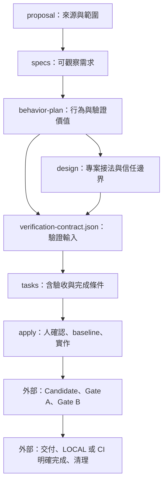

# OpenSpec 治理流程示例

這個目錄已實際執行 `openspec init`，並將預設 schema fork 成 `governed-delivery`。需求整理、行為計畫、Project Binding、驗證契約及任務追蹤交由 OpenSpec；可信驗收與完成清理仍是外部缺口。

**本示例是可載入、可檢查的流程配置，不是已實作的治理引擎。** 教學 change 的規劃文件齊全，但人工確認仍為 PENDING，九項執行工作皆未完成，也沒有產品程式或假 PASS。

## 快速閱讀

| 檔案 | 用途 |
|---|---|
| [GAPS.md](GAPS.md) | 已實測的限制、需外部補強的能力與建議順序 |
| [WORKFLOW.md](WORKFLOW.md) | 從規劃到 LOCAL／CI 完成的操作方式與責任界線 |
| [config.yaml](openspec/config.yaml) | 專案背景、各產物規則、apply／archive 指引 |
| [schema.yaml](openspec/schemas/governed-delivery/schema.yaml) | 六種產物、範本與相依關係 |
| [daily-check-in](openspec/changes/daily-check-in/proposal.md) | 完整但未核准實作的教學 change |
| [review-result.schema.json](contracts/review-result.schema.json) | reviewer 回覆格式提案，尚未接上接收端 |
| [check-example.mjs](scripts/check-example.mjs) | 可重跑的 CLI 整合檢查與限制探測 |

## 初始化紀錄

2026-10-01，使用本機 **OpenSpec 1.14.0**、OpenCode、`core` profile，實際執行：

```sh
# 在此目錄的上層執行；以下是建立紀錄，不需在既有示例重跑。
OPENSPEC_TELEMETRY=0 OPENSPEC_NO_UPDATE_CHECK=1 openspec init example \
  --tools opencode --profile core --language zh-TW --no-animation
cd example
openspec schema fork spec-driven governed-delivery
```

接著編輯 config、schema 與 templates，並用 `openspec new change daily-check-in` 建立教學 change。CLI 自動選用了 `governed-delivery`。

`.opencode/` 中的六組 skills／commands 為 init 產物，未直接修改。客製化放在專案 config 與 schema，降低 `openspec update` 重建指令檔時遺失設定的風險。升級仍需重跑檢查；schema commands 被 OpenSpec 標示為 experimental。

## 產物與流程



OpenSpec 的相依圖只涵蓋前六項**規劃產物**。驗證結果與 finalization 沒有偽裝成「產生檔案就算完成」的 artifact，而是 tasks 與 apply 的操作要求。指令輸出只提供給 Agent，沒有自動啟動 runner 或 reviewer。

## 檢查與試讀

需求：Node.js 22 以上、可從 PATH 執行的 OpenSpec 1.14.0。這份示例沒有另外安裝 npm 依賴。`OPENSPEC_BIN` 可指定另一個 OpenSpec 執行檔；不接受含參數的 shell 字串。

```sh
cd /path/to/project/example
openspec --version
openspec schema validate governed-delivery
openspec status --change daily-check-in
openspec instructions verification-contract --change daily-check-in --json
openspec instructions apply --change daily-check-in --json
openspec validate daily-check-in --strict
node scripts/check-example.mjs
```

`instructions` 只輸出指引，不執行 apply。教學資料會得到六個 `done` artifacts、apply `ready`、0/9 tasks；這是文件／清單狀態，不是實作授權或可信驗收。

檢查腳本已通過 **10 項**整合檢查：包含設定載入、strict spec validation、缺檔阻擋，以及 pending 確認、無效 JSON、過期計畫、無證據勾選與 archive 的限制。會在系統暫存目錄建立副本，僅在副本做破壞性探測，最後移除；不修改這份 change。

上述 PASS 只表示示例配置與所記錄的 CLI 行為符合預期。未執行產品測試、模型 review、權限隔離、CI 或完成清理；JSON Schema 文件也未接上 runtime validator。

## 用於真實任務

在此專案的 OpenCode 中，已安裝的規劃入口是 `/opsx-propose`，實作入口是 `/opsx-apply`；沒有安裝額外的 verify workflow，也沒有虛構 `gov complete` 指令。

若移入真實 repo，先以相同版本執行 `openspec init --tools opencode`，再合併本示例的 config、schema、WORKFLOW 與回覆契約；保留該專案原有規則。不要把教學 change 當成已核准的產品需求。既有 changes 會保留原本 schema，需要逐一評估，不能只改預設值就視為已遷移。

目前最小下一步是補一個真實專案的 binding、runner 與結果接收端，量測相對於「OpenSpec＋既有測試／CI＋reviewer」的增量價值。[補強順序與驗收條件](GAPS.md)
