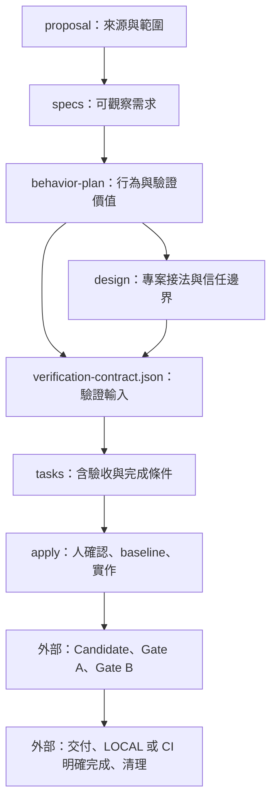

# OpenSpec 治理流程示例

通用工具入口已整理至 [SpecWit npm 套件](../packages/cli/README.zh-TW.md)。此目錄保留原 `governed-delivery` 教學 change，供對照與故障注入示範；不作為其他專案的安裝來源。

這個目錄已實際執行 `openspec init`，並將預設 schema fork 成 `governed-delivery`。需求整理、行為計畫、Project Binding、驗證契約及任務追蹤交由 OpenSpec；可信驗收與完成清理仍是外部缺口。

**本示例包含流程配置、已打包的 SpecWit CLI 與可重跑的小型模型示範。** 原 `daily-check-in` 教學 change 的人工確認仍為 PENDING，九項執行工作皆未完成；另以獨立的模型展示實際 PASS／FAIL，不代表真實產品或受保護治理引擎已完成。

## 直接看搭配效果

CLI 已輸出到本目錄的 `dist/`，可直接執行，不用先安裝 npm 套件：

```sh
cd /path/to/specwit/example
node scripts/demo.mjs
```

需要 Node.js 22.18 以上及 OpenSpec 1.14.0。若從 Git checkout 尚無 dist，從上層執行 `pnpm install --frozen-lockfile` 後，以 `pnpm example:demo` 建置並執行。

示範會實際跑：OpenSpec ready 但 SpecWit 阻擋 → 正常 checks PASS 但缺 review → 拒絕錯誤 evidence → Observe PASS → 移除 pending guard → 舊結果 STALE → 新 Run FAIL → 修正重驗 → 完成清理仍阻擋。

先看 [最新實際結果](demo-output/RESULTS.md)，再看 [搭配方式與手動操作](demo/README.md)。每次執行都留下新的可編輯專案與逐步 JSON；確認與 reviewer 回覆為明確標示的 synthetic fixture。

- [直接執行的 specwit.mjs](dist/specwit.mjs)
- [可安裝的壓縮套件](dist/sidtw-specwit-0.3.0.tgz)
- [Runner 設定](demo/governance/runner.json)、[Binding](demo/governance/binding.json)、[實際模型](demo/src/check-in.mjs)、[檢查程式](demo/checks/check-in.mjs)

## 快速閱讀

| 檔案 | 用途 |
|---|---|
| [GAPS.md](GAPS.md) | 已實測的限制、需外部補強的能力與建議順序 |
| [SpecWit CLI](../packages/cli/README.md) | 已實作的 Observe 檢查、runner、review 匯入與打包操作 |
| [WORKFLOW.md](WORKFLOW.md) | 從規劃到 LOCAL／CI 完成的操作方式與責任界線 |
| [config.yaml](openspec/config.yaml) | 專案背景、各產物規則、apply／archive 指引 |
| [schema.yaml](openspec/schemas/governed-delivery/schema.yaml) | 六種產物、範本與相依關係 |
| [daily-check-in](openspec/changes/daily-check-in/proposal.md) | 完整但未核准實作的教學 change |
| [review-result.schema.json](contracts/review-result.schema.json) | reviewer 回覆格式；SpecWit 接收端已載入驗證 |
| [check-example.mjs](scripts/check-example.mjs) | 可重跑的 CLI 整合檢查與限制探測 |

## 初始化紀錄

2026-10-01，使用本機 **OpenSpec 1.14.0**、OpenCode、`core` profile，實際執行：

```sh
# 在此目錄的上層執行；以下是建立紀錄，不需在既有示例重跑。
OPENSPEC_TELEMETRY=0 OPENSPEC_NO_UPDATE_CHECK=1 openspec init example \
  --tools opencode --profile core --language zh-TW --no-animation
cd example
openspec schema fork spec-driven governed-delivery
```

接著編輯 config、schema 與 templates，並用 `openspec new change daily-check-in` 建立教學 change。CLI 自動選用了 `governed-delivery`。

`.opencode/` 中的六組 skills／commands 為 init 產物，未直接修改。客製化放在專案 config 與 schema，降低 `openspec update` 重建指令檔時遺失設定的風險。升級仍需重跑檢查；schema commands 被 OpenSpec 標示為 experimental。

## 產物與流程



OpenSpec 的相依圖只涵蓋前六項**規劃產物**。驗證結果與 finalization 沒有偽裝成「產生檔案就算完成」的 artifact，而是 tasks 與 apply 的操作要求。指令輸出只提供給 Agent，沒有自動啟動 runner 或 reviewer。

## 檢查與試讀

OpenSpec 探測需求：Node.js 22 以上、可從 PATH 執行的 OpenSpec 1.14.0。此探測腳本沒有另外安裝 npm 依賴。`OPENSPEC_BIN` 可指定另一個 OpenSpec 執行檔；不接受含參數的 shell 字串。

```sh
cd /path/to/specwit/example
openspec --version
openspec schema validate governed-delivery
openspec status --change daily-check-in
openspec instructions verification-contract --change daily-check-in --json
openspec instructions apply --change daily-check-in --json
openspec validate daily-check-in --strict
node scripts/check-example.mjs
```

`instructions` 只輸出指引，不執行 apply。教學資料會得到六個 `done` artifacts、apply `ready`、0/9 tasks；這是文件／清單狀態，不是實作授權或可信驗收。

檢查腳本已通過 **10 項**整合檢查：包含設定載入、strict spec validation、缺檔阻擋，以及 pending 確認、無效 JSON、過期計畫、無證據勾選與 archive 的限制。會在系統暫存目錄建立副本，僅在副本做破壞性探測，最後移除；不修改這份 change。

上述 PASS 只表示示例配置與所記錄的 OpenSpec 行為符合預期。未執行產品測試、模型 review、權限隔離、CI 或完成清理。

另已加入 TypeScript 的 `specwit` CLI，可從儲存庫根目錄建置並檢查此示例（需 Node.js 22.18 以上及 pnpm）：

```sh
pnpm install --frozen-lockfile
pnpm cli:pack
node example/dist/specwit.mjs --help
# 不修改教學 change 的完整示範（含暫存副本 init）：
node example/scripts/demo.mjs
```

直接操作專案前先完成 `specwit init`。示範會在獨立副本執行初始化，再取得 `BLOCKED`、exit code 2：人確認、binding/verifier、runner 與版本摘要仍未準備。`specwit verify` 也會在前置檢查阻擋，不會建立原教學 change 的 runtime。CLI 的測試使用暫存 fixture；可操作示範則將資料保留在 demo-output，兩者都不將確認或結果寫回原教學 change。[完整指令與接入方式](../packages/cli/README.md)

## 用於真實任務

在此專案的 OpenCode 中，已安裝的規劃入口是 `/opsx-propose`，實作入口是 `/opsx-apply`。`specwit` 是另行建置／安裝的輔助 CLI，沒有自動安裝新的 OpenCode workflow；`specwit complete` 目前只預覽清理範圍。

若用於真實 repo，先完成 `openspec init`，安裝 SpecWit npm 套件，再執行 `specwit init`；英文為預設，繁中使用 `specwit init --language zh-TW`。工具會安裝通用 `specwit` schema 與必要提示詞，合併設定並保留原規則，不必複製此教學目錄。不要把教學 change 當成已核准的產品需求。既有 changes 會保留原本 schema，需要逐一評估，不能只改預設值就視為已遷移。

發布後的安裝與操作方式如下；尚未發布時使用上面的本機 npm 壓縮包：

```sh
npm install -g @sidtw/specwit
# 先在目標專案完成 openspec init
specwit init
specwit init --language zh-TW
specwit validate <change>
specwit verify <change>
specwit status <change>
```

既有安裝的 schema、設定與資料相容性見[遷移說明](../packages/cli/MIGRATION.zh-TW.md)。

目前最小下一步是用已實作的接收端接上一個真實專案的 binding 與 runner，再補可信執行邊界，量測相對於「OpenSpec＋既有測試／CI＋reviewer」的增量價值。[補強順序與驗收條件](GAPS.md)
